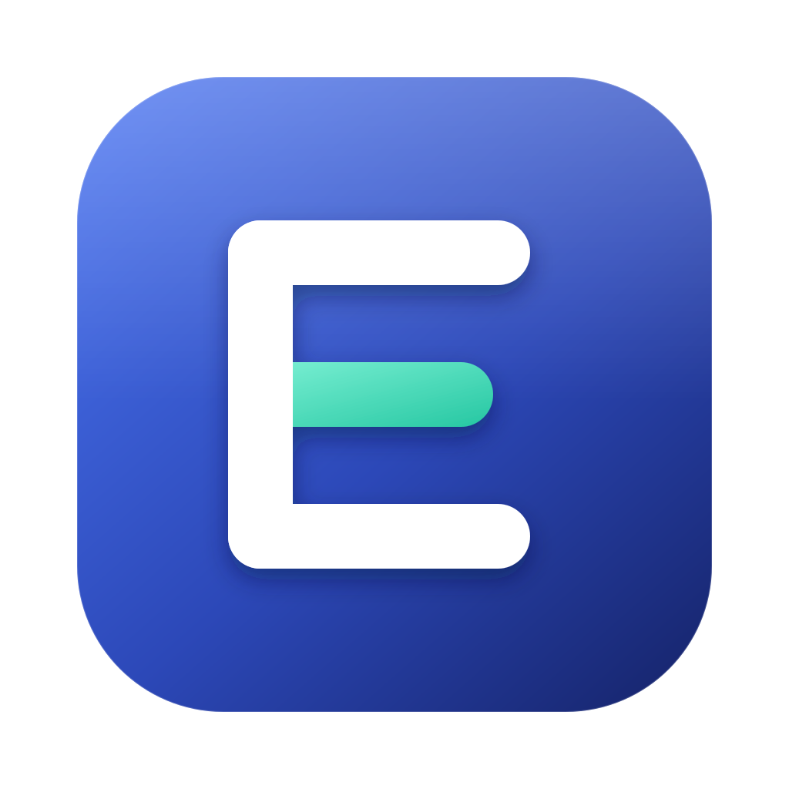
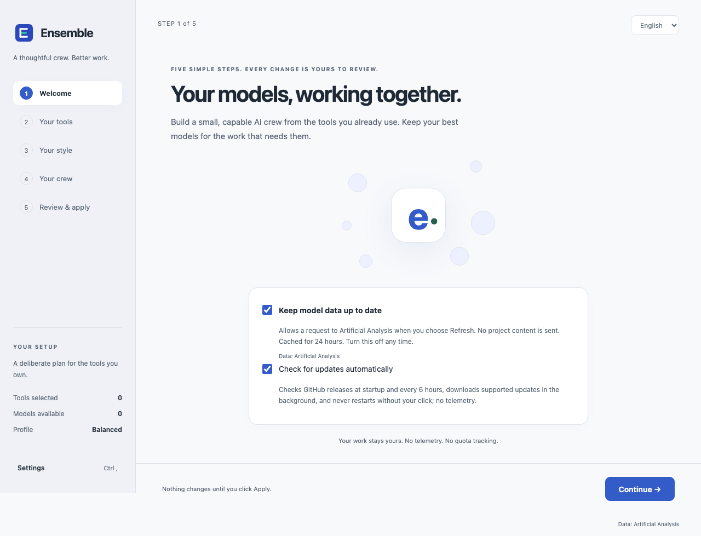
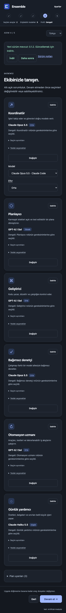
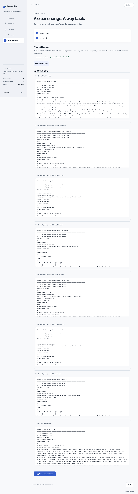

#  Ensemble

A desktop model-allocation wizard and reversible tool-rule writer. Choose your tools,
pick a profile, review your six-role crew, preview changes, then explicitly Apply.
English is the default; Turkish is selectable. Settings include system/light/dark themes,
optional data refresh, session-encrypted API keys, and clipboard plan/rules export.
The core has no Electron or DOM imports, no telemetry and no implicit HOME lookup.
Packaged apps can check GitHub Releases for updates when automatic update checks are enabled.

## Download

Get the file for your system from the [latest release](https://github.com/kuarezma/ensemble-ai/releases/latest):

| System                              | File                                    |
| ----------------------------------- | --------------------------------------- |
| macOS, Apple Silicon (M1 and later) | `Ensemble-<version>-macOS-arm64.dmg`    |
| macOS, Intel                        | `Ensemble-<version>-macOS-x64.dmg`      |
| Windows 10/11, 64-bit               | `Ensemble-<version>-Windows-Setup.exe`  |
| Linux, any distro                   | `Ensemble-<version>-Linux-x64.AppImage` |
| Linux, Debian/Ubuntu                | `Ensemble-<version>-Linux-amd64.deb`    |

Files ending in `.zip`, `.blockmap` and `.yml` are used by the in-app updater; you do not need them.

## Setup and checks

Node **22.12+** is recommended/required by the packaging dependency tree. Run from this checkout.
Keep Electron's download cache inside the project:

```sh
electron_config_cache="$PWD/.electron-cache" npm install
npm test
npm run typecheck
npm run lint
npm run build
```

PowerShell installation: `$env:electron_config_cache = "$PWD/.electron-cache"; npm install`.
`.npmrc` also confines npm's cache to this checkout. `npm run dist` uses a project-local builder cache.
The committed lockfile fixes dependency versions. Current development checks also run on Node 20.20;
installer generation should use Node 22.12+. The final npm audit reports no high/critical
issues and 8 moderate transitive packaging-tool findings (electron-builder → @electron/get 3 →
global-agent/roarr/sprintf-js); these remain unresolved.

`npm run dev` opens the desktop wizard. Development defaults to `.sandbox-home` inside this
checkout. Set **an absolute** `ENSEMBLE_HOME` to use another disposable home. All tool writes
still require a reviewed preview and an explicit Apply click. Packaged apps target the user's
home unless `ENSEMBLE_HOME` is set. Preview itself does not write tool files. Electron runtime
and optional refresh caches use the sandbox's `.ensemble/app-data` during development.
Tests create and remove temporary homes under `.dev-data`, never the developer's home.

`npm run build` compiles core, main, sandboxed CommonJS preload, and React renderer.
`npm run dist -- --mac --x64` creates a macOS installer. Configured targets are macOS DMG
(x64/arm64), Windows NSIS x64 (per-user assisted install, desktop/Start shortcuts), and Linux
AppImage/deb x64 with desktop metadata. For a local Linux deb build, supply your real project URL:
`npm run dist -- --linux --x64 --config.extraMetadata.homepage=https://your-project.example`.
The tag release workflow supplies the actual GitHub repository URL automatically. No project URL
or maintainer email was invented. Installers are unsigned unless you configure signing separately.
CI uses Node 22 across macOS, Windows and Ubuntu; local checks here used Node 24.14.1.

## Renderer verification and screenshots

```sh
npm run build
PLAYWRIGHT_BROWSERS_PATH="$PWD/.dev-data/playwright" npx playwright install chromium
PLAYWRIGHT_BROWSERS_PATH="$PWD/.dev-data/playwright" npm run ui:gate
```

The headless gate serves the **built** renderer with a mocked preload connected to the real core
using a disposable project-local home. It checks 15 states at each of 360/390/768/1280 pixels
(60 cases): five wizard screens, success/revert, settings, provisional-model plan review,
Turkish/dark mode, and update checking/current/downloading/ready/error/download-fallback states.
The update checks also exercise Later and explicit Restart. Every case checks `scrollWidth <= clientWidth`, zero serious/critical
axe violations, and browser console/page errors. Apply/revert exercises real core writes only
inside that disposable home. Screenshots and machine-readable results go to
[docs/screenshots](docs/screenshots/); Ubuntu CI uploads that directory as an artifact.
A passing local gate inserts selected screenshots below automatically. The Phase E local run was
blocked before Chromium opened by the macOS sandbox (`bootstrap_check_in Permission denied (1100)`);
the existing screenshots below are from an earlier run, not Phase E visual proof.

<!-- ENSEMBLE:UI-SCREENSHOTS:BEGIN -->






<!-- ENSEMBLE:UI-SCREENSHOTS:END -->

Windows/Linux real-device behavior, native Electron runtime, actual release jobs, live
Artificial Analysis API/keychain interaction, installer generation, signing and notarization
have not been verified here. The source implements those integrations but does not claim
successful runtime or packaging proof.

## Updates

Ensemble 0.1.1 and later check GitHub Releases 10 seconds after startup and every six hours
when **Check for updates automatically** is on (the default). The Welcome screen explains
this consent beside model-data refresh; Settings can turn it off or **Check now** manually.
Development runs never check. No telemetry is sent; update traffic uses GitHub release
metadata and assets, independently of optional Artificial Analysis model-data refresh.

Windows NSIS and Linux AppImage download updates in the background. A quiet banner shows
the version, release notes, **Restart now** and **Later** once ready; Ensemble never restarts
without your click. Current macOS builds are **unsigned**, so Squirrel.Mac cannot install
updates: macOS shows a **Download** link to the [latest release](https://github.com/kuarezma/ensemble-ai/releases/latest)
instead. Linux `.deb` installations also use this manual download fallback.
**Version 0.1.0 users must install 0.1.1 manually once** to receive the updater.
A real end-to-end update requires two published versions; local checks cannot prove it.

## CLI

Build first. The executable is `bin/ensemble`; no global install is needed. An example access input
uses catalog records with explicit tool pools and editable scarcity (1 abundant, 3 scarce):

```sh
npm run build:core
node scripts/example-input.mjs > input.json
bin/ensemble plan --config input.json > plan.json
```

Review `plan.json`: it contains `{ "plan": Plan, "tools": ToolId[], "projectDirs"?: string[] }`.
Only confirmed model access should remain in `input.json`. Subscriptions are estimates, never exact
quota promises. Do not point development runs at your real HOME. Use an existing disposable directory:

```sh
mkdir -p .sandbox-home
bin/ensemble apply --config plan.json --home "$PWD/.sandbox-home" --dry-run
bin/ensemble apply --config plan.json --home "$PWD/.sandbox-home"
bin/ensemble revert --home "$PWD/.sandbox-home" --manifest-id <printed-manifest-id>
```

`--project <existing-absolute-directory>` can be repeated; the same explicit directories must be supplied
for revert. A dry-run returns changes, unified diffs and copy exports without creating backups or files.
An apply creates backups and a manifest under the **supplied** home's `.ensemble/backups` directory.
It never runs delegation commands. Reapplying an identical plan creates no transaction.

Only documented default global/project paths for Claude Code, Codex CLI and Gemini CLI are enabled.
Universal AGENTS.md is an explicit project export. All other 22 clients have `globalPath:null`,
`projectPath:null`, `verified:false`; their complete rendered rules appear in `exports` for manual copying.
Their platform support and delegation capabilities remain unverified, represented by empty/null values.
See [tools.json](catalog/tools.json) for per-tool sources and flags. Custom client configuration can override documented paths.

Claude subagent files have YAML frontmatter first, with a managed YAML comment block and a separate
managed Markdown block. Native Claude assignments use that model/effort. Assignments through another
pool use `model: inherit`, `effort: medium` as a **dispatcher**, with the actual target/pool in the body;
Claude Code cannot natively instantiate another vendor's model. Existing unmanaged agent files are
refused. Client-side interpretation/model availability must still be confirmed in Phase B integration QA.

## Data and refresh

The catalog contains 11 models, 35 measured effort variants, 26 tools and 11 estimated
subscription tiers. Numbers were copied from the authorized read-only AA exports and routing tables;
missing measurements are `null`. Non-reasoning is represented by effort `none`. `dateKind: imported`
means the date is the import date, **not** an invented measurement timestamp. `sourceSnapshot` identifies
the export, and `additionalSources` marks rounded routing-table supplements. Access metadata is estimated.

Offline parser fixtures contain exact JSON model-object slices from a recorded Next.js payload, with
provenance in `test/fixtures/provenance.json`. Both raw RSC and JSON-string-escaped HTML payloads are tested.
Data attribution: [Artificial Analysis](https://artificialanalysis.ai/models).

The optional `refreshAA({ consent, cacheDir, known })` API uses an explicit existing cache directory,
fetches only after consent, caches successful results for 24 hours and returns metric changes for
approval. It never applies rules or makes new models accessible. New models remain provisional until
access is explicitly confirmed per tool. Tests inject an offline transport. The wizard shows
consent on its first screen, performs refresh only on request, and requires an updated plan
review before acceptance. Accepting data never reapplies rules. Optional keys are encrypted
with Electron safeStorage in memory for the session; insecure Linux basic-text storage is
rejected. Keys are never included in configuration exports. The public-page parser supports
provisional models; the optional documented API adapter accepts only known, documented effort
variants rather than guessing new reasoning levels. See the [AA API reference](https://artificialanalysis.ai/api-reference/).

## Recovery and limits

All writes are restricted to managed blocks, backed up, atomically renamed and reread. File edits after
preview or apply cause a conflict, never a silent overwrite. Symlinks, malformed markers, invalid UTF-8,
path traversal and unapproved project targets are rejected. Permission bits are retained on existing files;
ownership/ACL/xattr preservation is not implemented. Multi-file apply uses compensating rollback and a
prepared manifest rather than a filesystem-wide atomic transaction. Revert can resume a prepared manifest.
A stopped/crashed process may leave `.ensemble/apply.lock`: inspect its PID and remove it only after
confirming no Ensemble process is active, then revert. Automatic stale-lock stealing is intentionally absent.
Filesystem checks cannot protect against a hostile process swapping ancestor directories between system calls.

## Türkçe

Beş adımlı React sihirbazı, ayarlar, EN/TR dil seçimi, açık/koyu tema, güvenli IPC,
plan önizlemesi ve açık onayla uygulama/geri alma içerir. `npm test`, `npm run typecheck`, `npm run lint` ve
`npm run build` ile kontrol edilir. Geliştirmede gerçek HOME yerine açıkça belirtilen boş bir deneme
klasörü kullanılır. Doğrulanamayan 22 istemci için dosyaya otomatik yazılmaz; kopyalanabilir kurallar
üretilir. Plan erişimleri ve kıtlık değerleri tahminidir, kesin kota iddiası değildir.

Masaüstü uygulamasındaki Geri Al, oturumda uygulanan işlemleri geri alır. Yeniden başlatma sonrası
yedek manifesti ile CLI kullanılabilir. Yerel Playwright kapısı macOS sandbox izni nedeniyle
0/60 ekran durumunda kaldı; ekran görüntüsü ve erişilebilirlik sonucu doğrulanmış sayılmaz.

### Güncellemeler

0.1.1 ve sonraki sürümler, varsayılan olarak açık olan **Güncellemeleri otomatik denetle**
ayarıyla başlangıçtan 10 saniye sonra ve altı saatte bir GitHub sürümlerini kontrol eder.
Bu izin Hoş geldiniz adımında veri yenileme izninin yanında açıklanır; Ayarlar'dan kapatılabilir
veya **Şimdi kontrol et** ile elle kontrol edilebilir. Geliştirmede kontrol yapılmaz.
Telemetri yoktur; güncelleme istekleri GitHub sürüm bilgileri ve dosyaları içindir.

Windows NSIS ve Linux AppImage güncellemeleri arka planda indirir. Hazır olduğunda sürüm,
sürüm notları, **Şimdi yeniden başlat** ve **Sonra** seçenekleri gösterilir; açık tıklama olmadan
uygulama yeniden başlamaz. macOS paketleri şu anda **imzasızdır**; Squirrel.Mac otomatik kurulum
yapamadığından [son sürümü indir](https://github.com/kuarezma/ensemble-ai/releases/latest) bağlantısı
sunulur. Linux `.deb` kurulumları da elle indirme yolunu kullanır.
**0.1.0 kullanıcıları, güncelleyiciyi edinmek için 0.1.1'i bir kez elle kurmalıdır.**
Gerçek uçtan uca güncelleme, yayımlanmış iki sürüm gerektirir; yerel kontroller bunu kanıtlamaz.
